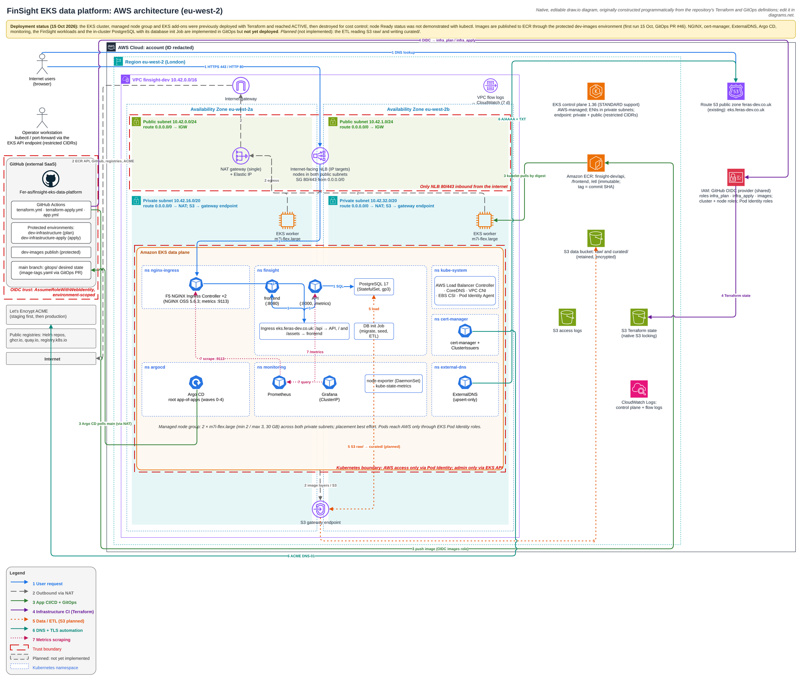

# FinSight

A local financial intelligence platform built with React/Vite, Python 3.12/FastAPI,
PostgreSQL and a real Pandas → Parquet → PostgreSQL ETL pipeline. **Synthetic GBP data only.**

Day 1 includes revenue/expense/profit reporting, departmental expense budgets, monthly
trends and transparent transaction risk indicators. ELT/dbt is reserved for Day 5.
The AWS infrastructure is defined in [infra/terraform](infra/terraform/README.md). The EKS cluster,
managed node group and EKS add-ons were previously deployed in eu-west-2 and reached ACTIVE, then destroyed
for cost control; node Ready status was not demonstrated with kubectl. The Kubernetes add-ons (NGINX,
cert-manager, ExternalDNS, Argo CD, monitoring) and the FinSight workloads are implemented in [gitops](gitops/)
but not yet deployed to a live cluster.

## Architecture



The editable diagrams.net source is [docs/architecture/finsight-architecture.drawio](docs/architecture/finsight-architecture.drawio),
a native draw.io diagram originally constructed programmatically from the Terraform and GitOps definitions.
It has three pages; each numbered flow is on its own layer:

1. **Overview**: Region, VPC, both AZs and subnets, NAT, NLB, EKS, regional services and all seven flows (above).
2. **Kubernetes platform**: namespaces, workloads, Services, sync waves and in-cluster flows ([PNG](docs/architecture/finsight-architecture-kubernetes.png)).
3. **CI/CD, IAM and data**: pipelines, GitHub OIDC roles, ECR, Terraform state and the planned ETL path ([PNG](docs/architecture/finsight-architecture-cicd.png)).

In-cluster PostgreSQL and its database init Job are implemented but not yet deployed; only the ETL path through S3 raw/curated is marked *planned*. Details:
[ingress](docs/infrastructure/ingress.md), [DNS and certificates](docs/infrastructure/dns-and-certificates.md),
[Argo CD](docs/infrastructure/argocd.md), [monitoring](docs/infrastructure/monitoring.md),
[application pipeline](docs/infrastructure/app-pipeline.md), [Terraform CI](docs/infrastructure/terraform-ci.md).

## Start locally from PowerShell

Prerequisite: Docker Desktop running Linux containers with Docker Compose v2.
Allow enough memory for PostgreSQL, Node and Python (4 GB Docker allocation recommended).
No host Python or Node installation is required for the Compose path.

```powershell
Set-Location 'C:\Users\Feras_F\Desktop\Dev Ops EKS Fin\finsight-eks-data-platform'
if (-not (Test-Path .env)) { Copy-Item .env.example .env }
docker compose config --quiet
docker compose up --build -d --wait frontend
docker compose ps -a
Start-Process 'http://localhost:5173'
```

The service dependencies run migrations, generate deterministic data and run ETL before
the API/frontend become healthy. `migrate`, `generate` and `etl` exiting with code 0 is expected.
API documentation: http://localhost:8000/docs. Health: `/api/health/live` and `/api/health/ready`.
Ports and resource settings live in `.env`; seed, year, departments and risk thresholds live
in `config/synthetic.json`. The default dashboard selects the generated year 2025.

## Verify

```powershell
powershell -NoProfile -ExecutionPolicy Bypass -File .\scripts\verify.ps1
```

This runs Python unit/integration tests against an isolated ephemeral database, React
tests and production build, then HTTP smoke checks through the running frontend proxy.
The execution-policy override applies only to this script process; no policy is changed.
Use `-SkipSmoke` to run tests without starting the app. Failures stop the script.

Individual checks:

```powershell
docker compose --profile test run --build --rm test
docker compose --profile test run --build --rm frontend-test
Invoke-RestMethod 'http://localhost:8000/api/health/ready'
Invoke-RestMethod 'http://localhost:5173/api/dashboard?start=2025-01-01&end=2026-01-01'
```

Re-run ETL against existing raw files (no duplicate records):

```powershell
docker compose run --rm --no-deps etl
```

Configuration is copied into the images at build time. After changing the seed,
year, departments or risk thresholds, rebuild before regenerating and loading:

```powershell
docker compose build generate etl api
docker compose run --rm --no-deps generate
docker compose run --rm --no-deps etl
docker compose up -d --no-deps --wait api
```

Migrations can also be run explicitly: `docker compose run --rm migrate`.
Inspect job output with `docker compose logs migrate generate etl`.
Stop while retaining application data: `docker compose --profile test down`.
To deliberately erase the local PostgreSQL volume, use `docker compose --profile test down --volumes`.
Generated raw/Parquet/rejection files remain under `data/`.

## Repository

| Location | Responsibility |
|---|---|
| `apps/frontend` | React UI, Vite proxy, UI tests, container |
| `apps/api` | Read-only FastAPI reporting, API tests, shared Python container |
| `pipelines/src/finsight_pipelines` | Synthetic generation, ETL and reserved ELT contract |
| `warehouse/migrations` | Ordered, checksummed PostgreSQL migrations |
| `warehouse/dbt` | Day 5 ELT model contract only |
| `config/synthetic.json` | Reproducible dataset/rule parameters |
| `tests/integration` | Real PostgreSQL load, rerun, rollback and API checks |
| `scripts` | Short migration and verification entry points |
| `docs` | KPI definitions, architecture, assessment mapping and evidence |

Python dependencies are centralised in `pyproject.toml` and frozen in `requirements.lock`
and `requirements-dev.lock`. Frontend dependencies are frozen in `package-lock.json`.
The shared Python image keeps Day 1 configuration small; packages retain separate ownership.

Optional host checks (Python 3.12 and Node 24 required):

```powershell
python -m venv .venv
.\.venv\Scripts\python.exe -m pip install -r requirements-dev.lock
.\.venv\Scripts\python.exe -m pytest -q --basetemp=.cache/pytest
.\.venv\Scripts\ruff.exe check .
.\.venv\Scripts\ruff.exe format --check .
Push-Location apps/frontend
npm.cmd ci
npm.cmd test
npm.cmd run build
npm.cmd run format:check
Pop-Location
```

Host tests skip PostgreSQL integration unless explicitly configured. Compose runs all of them.
See [KPI definitions](docs/kpi-definitions.md), [architecture](docs/architecture/day1.md),
[assessment tracker](docs/assessment-tracker.md) and [actual verification](docs/evidence/day1-verification.md).
