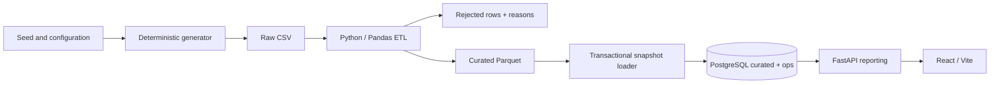

# Day 1 local architecture

Docker Compose owns local orchestration. PostgreSQL becomes healthy, migrations run,
generation completes, then ETL runs before API readiness and frontend startup. Only
the frontend and API are exposed, bound to localhost. PostgreSQL has no published port.
The frontend development server proxies `/api` to the API service. All services are local.

One shared Python image and one root dependency definition avoid duplicate environment
management during Day 1. The API and pipeline retain separate packages. Psycopg and
versioned SQL keep persistence explicit; no ORM, task queue, scheduler or cloud emulator.
The API dependency uses read-only database transactions. The local Compose database role
also owns migrations/ETL: separate least-privilege roles belong to the later deployment work.

Test services have their own ephemeral PostgreSQL database. Integration tests refuse to
run unless explicitly enabled and `PGDATABASE=finsight_test`. They never reset app data.

## ETL / ELT boundary

Day 1: transform source records in Python, write Parquet, load curated PostgreSQL tables.
Day 5: load source-shaped data into separate raw tables first, then transform through dbt.
Only README contracts reserve the ELT workspaces today. No dbt dependency or ELT execution.

## Deliberate limits

- No authentication or public hosting: synthetic demonstration on localhost only.
- Vite development serving is appropriate here; production serving is deferred.
- Full snapshots suit 10,000 transactions. Locks and transaction boundaries protect loads;
  larger incremental ingestion is out of Day 1 scope.
- No AWS, Terraform, Kubernetes, Helm, CI/CD or monitoring implementation yet.
- Before later deployment, reconcile the NGINX requirement with the retirement of the
  community ingress-nginx controller and the exact assessment rubric.
- The final AWS diagram will be an original draw.io artifact using official icons and
  account/Region/VPC/subnet/EKS boundaries. This local Mermaid is not that deliverable.

Implementation references: [Psycopg transactions](https://www.psycopg.org/psycopg3/docs/basic/transactions.html),
[FastAPI tests](https://fastapi.tiangolo.com/tutorial/testing/),
[Vite](https://vite.dev/guide/),
[Ingress NGINX retirement](https://kubernetes.io/blog/2025/11/11/ingress-nginx-retirement/).
