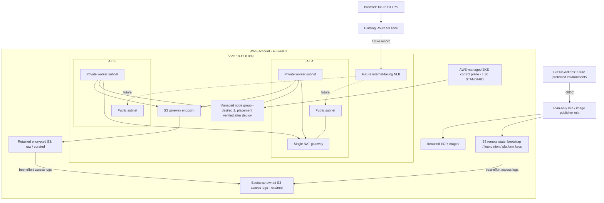

# Day 2 AWS architecture

Status: Terraform implemented and locally validated; deployment unverified.

The control plane is AWS-managed, outside the customer worker subnets. EKS creates network
interfaces in the selected private subnets. Its public API endpoint permits explicit CIDRs;
private access supports nodes and future in-cluster ArgoCD. Terraform uses AWS APIs only;
a public GitHub runner does not need Kubernetes API access for this infrastructure layer.

One managed node group spans both private subnets. ASG balancing is best effort; do not
describe it as one worker per AZ without checking actual instance and Kubernetes labels.
Desired/minimum default to two, maximum to three. No autoscaler is installed: maximum is a
capacity bound, not a promise of automatic scaling. Managed upgrades can temporarily add
instances, so account quotas/cost headroom must be checked.

Bootstrap add-ons are ordered: Pod Identity Agent, then VPC CNI and kube-proxy, then workers,
then CoreDNS and EBS CSI. CNI runs with its own identity, avoiding permanent CNI permissions
on the node role. ETL's Pod Identity association is reserved for
`finsight/finsight-etl`; creating the namespace/service account/job is deferred.

The data bucket has separate raw/curated access prefixes. Day 1's real ETL remains unchanged;
its S3 execution adaptation is later work. ELT/dbt remains a distinct Day 5 path and is not
implemented by infrastructure configuration.

## Future ingress and application boundary

Plan the maintained **F5 NGINX Ingress Controller (open source)**. Assessor acceptance is
**pending**. Do not deploy the retired community ingress-nginx project. F5 has different
chart values, annotations and CRDs; examples for community ingress-nginx are not interchangeable.

A later AWS Load Balancer Controller will provision an internet-facing NLB across the public
subnets for F5's LoadBalancer Service. It needs a separately reviewed Pod Identity policy,
webhook reachability and controller-owned security-group rules. Neither that controller nor
the NLB is created today. F5 terminates HTTPS with CertManager certificates. ExternalDNS
will own only the approved hostname and its ownership TXT record in the existing public zone;
CertManager DNS-01 will need narrowly scoped challenge TXT changes.

No DNS write permissions, ingress/CertManager/ExternalDNS identities or manifests are
preemptively deployed. These permissions will be reviewed against the actual later chart
service accounts. ArgoCD, monitoring, application Helm releases and CI workflows are deferred.

The single NAT and future single PostgreSQL replica are assessment cost compromises, not a
production HA design. EBS volumes are zonal: use encrypted gp3 and WaitForFirstConsumer later,
set deliberate reclaim policies, and test restore. A backup in retained S3 is distinct from a
PVC or root disk, which is not protected by this foundation state.

This Mermaid diagram documents Day 2 implementation ownership and is kept for history. The
assessment architecture diagram is the editable draw.io source
[finsight-architecture.drawio](finsight-architecture.drawio) and its exported PNGs (G09).
